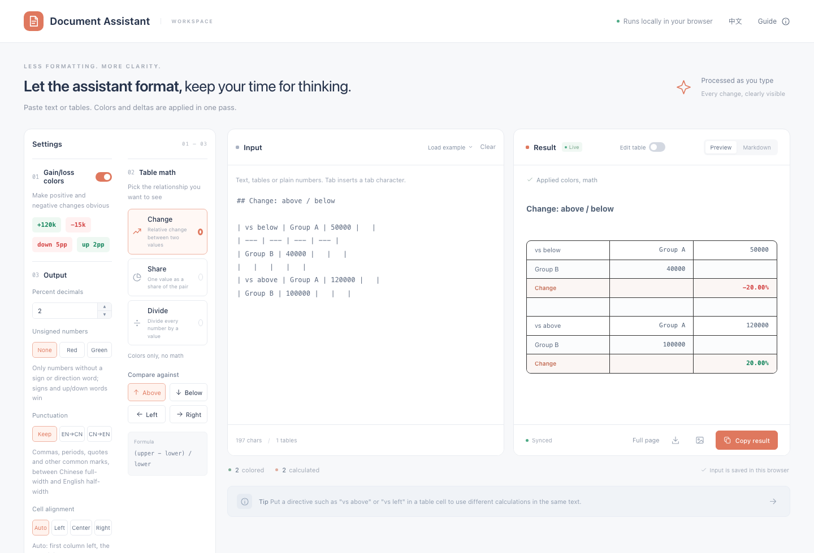

**English** | [中文](README.zh-CN.md)

# Document Assistant

A single-file web tool for tidying up numbers in reports. Paste text or a table and it colors gains green and losses red, calculates changes, shares and divisions between rows or columns, and gives you a result you can paste into a rich-text editor, export as Markdown, or copy as an image.

Everything runs in your browser. Nothing is uploaded; your last input is kept in the browser's localStorage.


## Quick start

Try it online: https://applespriter.github.io/document-assistant/ (中文: https://applespriter.github.io/document-assistant/zh-CN.html)

Or download `index.html` and open it in a browser. No install, no build, no dependencies.

- `index.html`: English UI (default)
- `zh-CN.html`: Chinese UI

Use the 中文 / English link in the top bar to switch.

## Features

- **Gain/loss colors**: signed values such as `+120k`, `-15k`, `+30w`, `-8` are colored. `down 3pp` / `up 2pp` follow the direction word right before the number. Unsigned numbers can optionally be colored red or green.
- **Table math** on Markdown tables, tab-separated data copied from a spreadsheet, or plain space-separated numbers:
  - Change: `(target − base) / base`, comparing above, below, left or right
  - Share: `chosen / (upper + lower)`
  - Divide: every number divided by a value (default 7)
- **Directives in cells** override the sidebar per block: `vs above`, `vs below`, `vs left`, `vs right`, `upper share`, `lower share`, `divide by 7`. Chinese directives (`看上方`, `除以 7` …) also work. A blank row starts a new group.
- **Output options**: percent decimals, Chinese ↔ English punctuation (URLs, numbers and code are left alone), cell alignment, `\[ \]` / `\( \)` to `$` / `$$`, table detection on/off.
- **Edit table**: hover the result table to delete a row or column; the input is updated and ⌘/Ctrl+Z undoes it.
- **Export**: copy rich text with colors, copy Markdown with color spans, download `.md`, copy as PNG, or open a full-page preview for screenshots.
- Units: `k` (thousand), `M` (million), `B` (billion), `w` / `万` (10 thousand), `亿` (100 million).

## Example

Input:

```
| vs below | Group A | 50000 |
| --- | --- | --- |
| Group B | 40000 | |
|   |   |   |
| vs above | Group A | 120000 |
| Group B | 100000 | |
```

Result: a `Change` row with `-20.00%` for the first block and `20.00%` for the second.



All numbers in the examples and screenshots are made up for demonstration.
