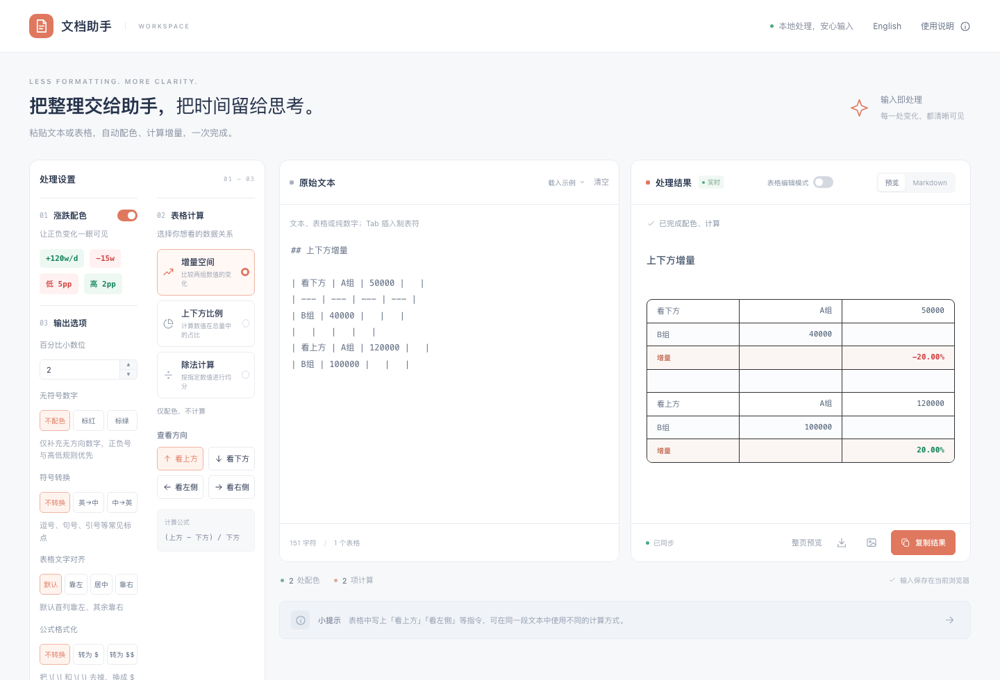

[English](README.md) | **中文**

# 文档助手

整理报告里数字的单文件网页工具。粘贴文本或表格后，自动把涨幅标绿、跌幅标红，按行或列计算增量、占比和除法，结果可以粘贴到富文本编辑器、导出 Markdown 或复制为图片。

所有处理都在浏览器本地完成，不上传任何内容；最近一次输入保存在浏览器 localStorage 中。


## 使用

下载 `zh-CN.html` 用浏览器打开即可，无需安装或构建。

- `index.html`：英文版（默认）
- `zh-CN.html`：中文版

顶栏的 English / 中文 链接可以切换语言。

## 功能

- **涨跌配色**：`+120w/d`、`-15w`、`+12` 等带正负号的数值自动配色；「低 3pp」「高 2pp」按紧邻的方向词配色；无符号数字可选标红或标绿。
- **表格计算**：支持 Markdown 表格、从电子表格复制的制表符数据、空格分隔的纯数字。
  - 增量：`(目标 − 基准) / 基准`，可看上方、下方、左侧、右侧
  - 比例：`选中一方 / (上方 + 下方)`
  - 除法：每个数值除以指定数（默认 7）
- **单元格指令**：写「看上方」「看下方」「看左侧」「看右侧」「上方比例」「下方比例」「除以 7」可覆盖侧栏设置，空白行分隔不同数据组。
- **输出选项**：百分比小数位、中英文符号互换（网址、数字、代码保持原样）、表格文字对齐、`\[ \]` / `\( \)` 转 `$` / `$$`、表格识别开关。
- **表格编辑模式**：鼠标移到结果表格上可删除行或列，左侧原文同步修改，⌘/Ctrl+Z 可撤销。
- **导出**：复制带颜色的富文本、复制带颜色 span 的 Markdown、下载 `.md`、复制为 PNG、整页预览截图。

## 示例

输入：

```
| 看下方 | A组 | 50000 |
| --- | --- | --- |
| B组 | 40000 | |
|   |   |   |
| 看上方 | A组 | 120000 |
| B组 | 100000 | |
```

结果：第一组增量 `-20.00%`，第二组 `20.00%`。



示例和截图中的数字均为虚构的演示数据。
